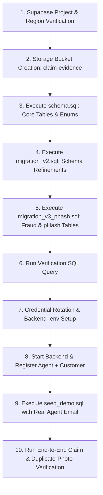

# ClaimPilot — Supabase Setup & Security-Readiness Guide

**Target Audience:** Project Lead / Platform Operator
**Repository Branch:** `security/backend-hardening`
**Current State:** Supabase setup and credential rotation are pending. No successful end-to-end claim has been established in the handoff.
**Objective:** Provide a verified, reproducible execution order and verification protocol to bring Supabase, authentication, storage, and fraud engine into a verified operational state without hardcoding or leaking credentials.

---

## 1. Ground Truth: Repository Facts vs. Remote Assumptions

Before executing any commands, understand the boundary between checked-in repository code and remote infrastructure:

| Component | Repository Fact (Verified by Code Inspection) | Remote Operator State (Must Be Verified in Supabase) |
|---|---|---|
| **Base Schema** | `schema.sql` defines `profiles`, `otp_verifications`, `claims`, `claim_evidence`, `claim_ai_analysis`, enums (`user_role`, `claim_type`, `claim_status`), and `uuid-ossp` extension. | **Unverified.** Table existence cannot be assumed merely because `.sql` files exist in git. |
| **Schema Refinements** | `migration_v2.sql` adds missing columns: `claims.location_city`, `claims.pincode`, `claims.claimed_amount`, `claims.approved_amount`, and `claim_evidence.storage_path`. | **Unverified.** If missing, claim creation or evidence cataloging fails with column-missing database errors. |
| **pHash / Fraud Schema** | `migration_v3_phash.sql` adds `claim_evidence.phash`, `idx_claim_evidence_phash`, `claim_fraud_analyses` table, and `claim_ai_analysis` fraud fields. | **Unverified.** If missing, `fraud_analysis_service.py` explicitly raises `PhashColumnMissingError` upon photo upload. |
| **Policy Seed** | `seed_demo.sql` creates `agent_policies` & `policies` tables, adds RLS, and seeds `DEMO-POL-001..003` assigned to `<AGENT_EMAIL_PLACEHOLDER>`. | **Unverified.** `claims.py:57-87` strictly mandates that `agent_policies` maps the submitted policy to an existing agent in `public.profiles`. |
| **Storage Bucket** | Backend defaults to `SUPABASE_STORAGE_BUCKET="claim-evidence"`. Files are saved under `evidence/{category}/{user_id}/...`. The backend uses service-role storage operations and time-limited signed URLs where needed. | **Unverified.** The `claim-evidence` bucket must exist as a **Private** bucket, with backend credentials configured for required storage operations. |
| **Backend PostgREST Client** | `app/db/supabase.py` initializes `AsyncSupabaseDB` with `SUPABASE_SERVICE_ROLE_KEY`. Queries bypass Postgres Row Level Security (RLS). | Remote RLS policies do not restrict the FastAPI backend, but anon/client access requires explicit policies. |
| **Backend JWT Secret** | `app/core/security.py` signs and verifies application session tokens and email action links using `JWT_SECRET`. | **Separate from Supabase JWT secret.** The backend JWT secret must be an independently generated random 256-bit key. |

---

## 2. Correct Setup Order (Dependency-Driven)

Executing scripts out of order will result in foreign key errors or missing column exceptions. Follow this strict sequence:



---

## 3. Remote Supabase Verification & Migration Execution

### Step 3.1: Verify Region and Project Status
1. Navigate to the **Supabase Dashboard** (`https://supabase.com/dashboard/project/<project-ref>`).
2. Go to **Project Settings** > **General**:
   - Confirm **Status** is `ACTIVE_HEALTHY` (not paused or provisioning).
   - Note the **Region** (e.g., `ap-south-1` Mumbai or `us-east-1`). Low latency to the backend host is recommended.

### Step 3.2: Configure Storage (`claim-evidence`)
1. Go to **Storage** > **New Bucket**.
2. Set **Bucket Name**: `claim-evidence` (exact match with `SUPABASE_STORAGE_BUCKET` in `.env.example`).
3. Set **Public Bucket**: **Disabled** (`OFF`). Claim evidence must not be publicly readable.
   > **How access works:** The backend generates signed upload URLs and downloads evidence for AI assessment through its service-role storage client. Signed read URLs are time-limited. Never expose signed URL tokens in logs.
4. Set **File size limit**: `50MB` (matches `MAX_FILE_SIZE_BYTES` in `storage.py:25`).
5. Set **Allowed MIME types**: `image/jpeg, image/png, image/webp, video/mp4, video/quicktime`.

### Step 3.3: Execute Schema & Migrations in SQL Editor
Navigate to **SQL Editor** in the Supabase Dashboard and execute the following repository files in sequence:

1. **Base DDL:** Paste and run [insurance-pro/backend/schema.sql](file:///c:/Projects/claimbot%20AI/ClaimPilot-Final/insurance-pro/backend/schema.sql).
   - Verifies extensions (`uuid-ossp`).
   - Creates ENUMs: `user_role`, `claim_type`, `claim_status`.
   - Creates tables: `public.profiles`, `public.otp_verifications`, `public.claims`, `public.claim_evidence`, `public.claim_ai_analysis`.
2. **Schema Refinement:** Paste and run [insurance-pro/backend/migration_v2.sql](file:///c:/Projects/claimbot%20AI/ClaimPilot-Final/insurance-pro/backend/migration_v2.sql).
   - Adds `pincode`, `location_city`, `location_state`, `claimed_amount`, `approved_amount` to `claims`.
   - Adds `storage_path` to `claim_evidence`.
3. **Fraud & pHash Engine:** Paste and run [insurance-pro/backend/migration_v3_phash.sql](file:///c:/Projects/claimbot%20AI/ClaimPilot-Final/insurance-pro/backend/migration_v3_phash.sql).
   - Adds `phash VARCHAR(16)` to `claim_evidence` and index `idx_claim_evidence_phash`.
   - Creates `public.claim_fraud_analyses` table.
   - Adds fraud fields to `claim_ai_analysis`.

### Step 3.4: Operator Verification SQL Query
Run this single read-only diagnostic query in the Supabase SQL Editor to verify database readiness:

```sql
-- Diagnostic Readiness Check: Run in Supabase SQL Editor
WITH table_check AS (
    SELECT table_name
    FROM information_schema.tables
    WHERE table_schema = 'public'
      AND table_name IN (
        'profiles', 'otp_verifications', 'claims',
        'claim_evidence', 'claim_ai_analysis', 'claim_fraud_analyses'
      )
),
column_check AS (
    SELECT table_name || '.' || column_name AS col
    FROM information_schema.columns
    WHERE table_schema = 'public'
      AND (
        (table_name = 'claim_evidence' AND column_name IN ('phash', 'storage_path')) OR
        (table_name = 'claims' AND column_name IN ('pincode', 'location_city', 'claimed_amount')) OR
        (table_name = 'claim_ai_analysis' AND column_name IN ('fraud_analysis', 'analysis_status'))
      )
),
bucket_check AS (
    SELECT name, public
    FROM storage.buckets
    WHERE name = 'claim-evidence'
)
SELECT
    (SELECT count(*) FROM table_check) AS existing_core_tables, -- Expect: 6
    (SELECT count(*) FROM column_check) AS existing_critical_columns, -- Expect: 7
    (SELECT public FROM bucket_check) AS bucket_is_public; -- Expect: true
```

*Required Verification Output:*
- `existing_core_tables`: **6**
- `existing_critical_columns`: **7**
- `bucket_is_public`: **true**

---

## 4. Credential Rotation, Backend JWT Secret & Local Environment

### Step 4.1: Rotate Supabase Keys (Project Lead Action)
1. In the Supabase Dashboard, go to **Project Settings** > **API**.
2. If keys were previously committed or shared insecurely, click **Generate new API keys** (or **Rotate JWT Secret** if rotating the underlying Supabase Auth token secret).
3. Note the following three values:
   - **Project URL** (`https://<project-ref>.supabase.co`)
   - **anon / public key**
   - **service_role secret key** (Keep secret; gives full database bypass privileges)

### Step 4.2: Generate Independent Backend JWT Secret
The backend application signs its own session tokens via `app/core/security.py` using `HS256`. It **must not** reuse the Supabase JWT secret or service role key.

Run this PowerShell command to generate a cryptographically strong 256-bit random secret:
```powershell
# Run in PowerShell to generate a 32-byte secure base64 secret
$randomBytes = New-Object byte[] 32
[System.Security.Cryptography.RandomNumberGenerator]::Create().GetBytes($randomBytes)
$backendJwtSecret = [Convert]::ToBase64String($randomBytes)
Write-Output "Generated JWT_SECRET: $backendJwtSecret"
```

### Step 4.3: Create Local `.env` File
Create `insurance-pro/backend/.env` based on `insurance-pro/backend/.env.example`. Replace placeholders with real values (never commit this file):

```ini
# ══════════════════════════════════════════════════════
# ClaimPilot Backend Environment Configuration
# File: insurance-pro/backend/.env (DO NOT COMMIT)
# ══════════════════════════════════════════════════════

# ── Required Supabase Credentials ─────────────────────
SUPABASE_URL="https://<your-project-ref>.supabase.co"
SUPABASE_ANON_KEY="<your-supabase-anon-key>"
SUPABASE_SERVICE_ROLE_KEY="<your-supabase-service-role-key>"
SUPABASE_STORAGE_BUCKET="claim-evidence"

# ── Required JWT Configuration ────────────────────────
JWT_SECRET="<paste-generated-backend-jwt-secret-here>"
JWT_ALGORITHM="HS256"
JWT_ACCESS_TOKEN_EXPIRE_MINUTES=1440

# ── Frontend & CORS ──────────────────────────────────
FRONTEND_URL="http://localhost:5173"
ALLOWED_ORIGINS="http://localhost:5173"

# ── Optional Fraud Detection Engine ───────────────────
PHASH_DISTANCE_THRESHOLD=5
FRAUD_LLM_PROVIDER="openai"
FRAUD_LLM_API_KEY=""
FRAUD_LLM_MODEL="gpt-4o-mini"

# ── Optional Notifications (Console Fallback Active) ──
SMTP_HOST="smtp.claimpilot.internal"
SMTP_PORT=587
SMTP_USER="notifications@claimpilot.com"
SMTP_FROM_EMAIL="notifications@claimpilot.com"
SMTP_FROM_NAME="ClaimPilot Claims Engine"
SUPPORT_EMAIL="support@claimpilot.com"
```

### Step 4.4: Verify `.gitignore` and Check Configuration
Verify that Git ignores your `.env` file:
```powershell
# Verify .env is safely ignored
git check-ignore insurance-pro/backend/.env
# Expected output: insurance-pro/backend/.env
```

Execute a safe pre-flight configuration test in PowerShell without starting the network server:
```powershell
# Run from repository root
Set-Location "insurance-pro\backend"
.\.venv\Scripts\python.exe -c "from app.core.config import settings; print('[SUCCESS] Config loaded for:', settings.PROJECT_NAME); print('Storage Bucket:', settings.SUPABASE_STORAGE_BUCKET)"
Set-Location "..\..\"
```

---

## 5. Account Registration & Demo Policy Seeding

`app/api/v1/claims.py:57-98` strictly mandates:
1. The submitted `policy_number` must exist in `public.agent_policies`.
2. The `agent_id` in `agent_policies` must exist in `public.profiles`.

Therefore, the **Agent account must be registered first**, before running the demo policy seed.

### Step 5.1: Start the Backend Service
In a dedicated PowerShell terminal:
```powershell
Set-Location "C:\Projects\claimbot AI\ClaimPilot-Final\insurance-pro\backend"
.\.venv\Scripts\Activate.ps1
uvicorn app.main:app --host 127.0.0.1 --port 8000 --reload
```

Verify backend health in a second PowerShell window:
```powershell
Invoke-RestMethod -Uri "http://127.0.0.1:8000/health"
# Expected response: @{status = "healthy"}
```

### Step 5.2: Register Demo Accounts (PowerShell)
Define operator variables and register the Agent and Customer. Credentials remain local in your PowerShell session:

```powershell
# Set local session variables (Customize as needed)
$AgentEmail = "agent@claimpilot.ai"
$AgentPassword = "SecureAgentPassword123!"
$CustomerEmail = "customer@claimpilot.ai"
$CustomerPassword = "SecureCustomerPassword123!"

# 1. Register Claims Agent
$AgentPayload = @{
    email = $AgentEmail
    password = $AgentPassword
    full_name = "Chief Claims Officer"
    phone_number = "+919876543210"
    dob = "1988-06-15"
    role = "agent"
} | ConvertTo-Json

$AgentReg = Invoke-RestMethod -Uri "http://127.0.0.1:8000/api/v1/auth/register" -Method Post -ContentType "application/json" -Body $AgentPayload
Write-Host "Agent Registered. User ID: $($AgentReg.user.id)"

# 2. Register Policyholder (Customer)
$CustomerPayload = @{
    email = $CustomerEmail
    password = $CustomerPassword
    full_name = "Ayaan Sutar"
    phone_number = "+919876543211"
    dob = "1996-04-20"
    role = "customer"
} | ConvertTo-Json

$CustomerReg = Invoke-RestMethod -Uri "http://127.0.0.1:8000/api/v1/auth/register" -Method Post -ContentType "application/json" -Body $CustomerPayload
Write-Host "Customer Registered. User ID: $($CustomerReg.user.id)"
```

### Step 5.3: Execute `seed_demo.sql`
1. Open [insurance-pro/backend/seed_demo.sql](file:///c:/Projects/claimbot%20AI/ClaimPilot-Final/insurance-pro/backend/seed_demo.sql).
2. In the Supabase SQL Editor, replace `<AGENT_EMAIL_PLACEHOLDER>` with the exact email used above (`agent@claimpilot.ai`).
3. Run the script. This creates `agent_policies` and `policies`, enables RLS with authenticated read access, and seeds:
   - `DEMO-POL-001` (Honda City 2022)
   - `DEMO-POL-002` (Hyundai Creta 2023)
   - `DEMO-POL-003` (Tata Nexon EV 2024)
4. Confirm mapping in the SQL Editor:
   ```sql
   SELECT ap.policy_number, p.full_name, p.email, p.role
   FROM public.agent_policies ap
   JOIN public.profiles p ON ap.agent_id = p.id;
   ```

---

## 6. End-to-End Claim & Duplicate-Photo Verification Protocol

Once the steps above are completed, execute this test checklist to confirm that Supabase storage, database writes, YOLO detection, and pHash duplicate checking are fully functional.

### Step 6.1: Obtain Customer Bearer Token
When registered via `/api/v1/auth/register`, an `access_token` is returned immediately in `$CustomerReg.access_token`. Alternatively, authenticate via 2FA login:

```powershell
$CustomerToken = $CustomerReg.access_token
$Headers = @{
    "Authorization" = "Bearer $CustomerToken"
}
```

### Step 6.2: File the First Claim (Claim A)
```powershell
$ClaimAPayload = @{
    policy_number = "DEMO-POL-001"
    incident_type = "Accident"
    vehicle_name = "Honda City 2022"
    hsrp_number = "MH12AB1234"
    engine_number = "ENG123456"
    chassis_number = "CHS123456"
    incident_date = "2026-10-10"
    location_address = "Western Express Highway, Mumbai"
    location_city = "Mumbai"
    location_state = "Maharashtra"
    pincode = "400050"
    description = "Front collision causing severe bumper deformation and crushed headlight."
    driver_name = "Ayaan Sutar"
    driver_dl_number = "MH1220110012345"
    claimed_amount = 45000.00
} | ConvertTo-Json

$ClaimARes = Invoke-RestMethod -Uri "http://127.0.0.1:8000/api/v1/claims" -Method Post -Headers $Headers -ContentType "application/json" -Body $ClaimAPayload
$ClaimAId = $ClaimARes.claim_id
Write-Host "Claim A Created: $ClaimAId ($($ClaimARes.claim_number))"
```

### Step 6.3: Upload Evidence Image (Presigned URL Flow)
Using a sample vehicle damage test photo (e.g. `damage.jpg`):

```powershell
$SampleImagePath = "C:\Projects\claimbot AI\ClaimPilot-Final\ml\scripts\damage.jpg" # Use any valid vehicle image
$FileBytes = [System.IO.File]::ReadAllBytes($SampleImagePath)

# 1. Request signed upload URL
$PresignPayload = @{
    file_name = "front_damage_01.jpg"
    file_type = "image/jpeg"
    category = "photo"
    file_size_bytes = $FileBytes.Length
} | ConvertTo-Json

$PresignRes = Invoke-RestMethod -Uri "http://127.0.0.1:8000/api/v1/storage/presigned-url" -Method Post -Headers $Headers -ContentType "application/json" -Body $PresignPayload
Write-Host "Presigned URL received: $($PresignRes.file_path)"

# 2. Upload binary directly to Supabase Storage via PUT
$UploadRes = Invoke-WebRequest -Uri $PresignRes.upload_url -Method Put -Body $FileBytes -ContentType "image/jpeg"
Write-Host "Direct upload status: $($UploadRes.StatusCode)" # Must be 200

# 3. Catalog evidence in database (Triggers background AI analysis)
$EvidencePayload = @{
    claim_id = $ClaimAId
    file_url = $PresignRes.public_url
    storage_path = $PresignRes.file_path
    file_type = "image/jpeg"
    category = "photo"
} | ConvertTo-Json

$CatalogRes = Invoke-RestMethod -Uri "http://127.0.0.1:8000/api/v1/storage/evidence" -Method Post -Headers $Headers -ContentType "application/json" -Body $EvidencePayload
Write-Host "Evidence Cataloged. AI background task dispatched."
```

### Step 6.4: Verify AI Assessment & Initial Hash Generation
Wait 10–15 seconds for background inference (`ai_runner.py`), then query claim details:
```powershell
Start-Sleep -Seconds 12
$ClaimADetails = Invoke-RestMethod -Uri "http://127.0.0.1:8000/api/v1/claims/$ClaimAId" -Headers $Headers

Write-Host "Claim A Status: $($ClaimADetails.claim.status)"
Write-Host "Damages Detected: $(($ClaimADetails.ai_analysis.detected_damages | ConvertTo-Json -Compress))"
Write-Host "Estimated Cost Range: ₹$($ClaimADetails.ai_analysis.estimated_cost_min) - ₹$($ClaimADetails.ai_analysis.estimated_cost_max)"
```

Check database evidence hash in Supabase SQL Editor:
```sql
SELECT id, claim_id, category, phash, storage_path
FROM public.claim_evidence
WHERE claim_id = '<paste-claim-A-uuid>';
-- Verify: phash is a 16-character hexadecimal string (e.g., 'd4a8e2b1c3f09a82')
```

### Step 6.5: Verify Fraud Duplicate-Photo Detection
File a second claim (Claim B) using policy `DEMO-POL-002` and upload the **exact same image**:

```powershell
# 1. Create Claim B
$ClaimBPayload = @{
    policy_number = "DEMO-POL-002"
    incident_type = "Accident"
    vehicle_name = "Hyundai Creta 2023"
    hsrp_number = "DL01CD5678"
    engine_number = "ENG987654"
    chassis_number = "CHS987654"
    incident_date = "2026-10-12"
    location_address = "Ring Road, New Delhi"
    location_city = "New Delhi"
    location_state = "Delhi"
    pincode = "110001"
    description = "Side scratch while parking."
    driver_name = "Ayaan Sutar"
    driver_dl_number = "DL0120150098765"
    claimed_amount = 12000.00
} | ConvertTo-Json

$ClaimBRes = Invoke-RestMethod -Uri "http://127.0.0.1:8000/api/v1/claims" -Method Post -Headers $Headers -ContentType "application/json" -Body $ClaimBPayload
$ClaimBId = $ClaimBRes.claim_id

# 2. Upload the identical image to Claim B
$PresignB = Invoke-RestMethod -Uri "http://127.0.0.1:8000/api/v1/storage/presigned-url" -Method Post -Headers $Headers -ContentType "application/json" -Body $PresignPayload
Invoke-WebRequest -Uri $PresignB.upload_url -Method Put -Body $FileBytes -ContentType "image/jpeg"

# 3. Catalog evidence for Claim B
$EvidenceBPayload = @{
    claim_id = $ClaimBId
    file_url = $PresignB.public_url
    storage_path = $PresignB.file_path
    file_type = "image/jpeg"
    category = "photo"
} | ConvertTo-Json

Invoke-RestMethod -Uri "http://127.0.0.1:8000/api/v1/storage/evidence" -Method Post -Headers $Headers -ContentType "application/json" -Body $EvidenceBPayload

# 4. Wait for fraud analysis runner
Start-Sleep -Seconds 12
```

### Step 6.6: Confirm Duplicate Fraud Flag
Query fraud analysis in Supabase SQL Editor:
```sql
SELECT
    claim_id,
    score,
    risk_level,
    indicators
FROM public.claim_fraud_analyses
WHERE claim_id = '<paste-claim-B-uuid>';
```

*Expected Verification Evidence:*
- `indicators` contains:
  ```json
  [
    {"passed": false, "message": "Image matches a previously submitted claim"}
  ]
  ```
- `score` reflects the duplicate penalty: baseline `10` + duplicate penalty `40` = **`50`** (Medium Risk) or higher.

---

## 7. Operator Readiness Sign-Off Checklist

Before declaring the deployment ready for the frontend demonstration, verify every box:

- [ ] **Supabase Health:** Remote project is active in target region.
- [ ] **Storage Bucket:** `claim-evidence` exists as a **Private** bucket, permits 50MB file sizes, and is accessible to the backend through configured storage credentials.
- [ ] **SQL Schemas:** `schema.sql`, `migration_v2.sql`, and `migration_v3_phash.sql` applied.
- [ ] **Schema Check:** Verification query confirms 6 core tables and 7 critical columns.
- [ ] **Secret Hygiene:** `insurance-pro/backend/.env` created from `.env.example`; `.env` is confirmed in `.gitignore`.
- [ ] **Dedicated JWT Secret:** Independent 256-bit `JWT_SECRET` generated and loaded by backend.
- [ ] **Agent Registered:** Agent profile created in `public.profiles`.
- [ ] **Policy Seed:** `seed_demo.sql` executed with registered agent email.
- [ ] **First Claim Tested:** Claim A created, image uploaded via signed URL, AI assessment generated damages.
- [ ] **Duplicate Detection Verified:** Claim B with duplicate image triggered `Image matches a previously submitted claim` in `claim_fraud_analyses`.
